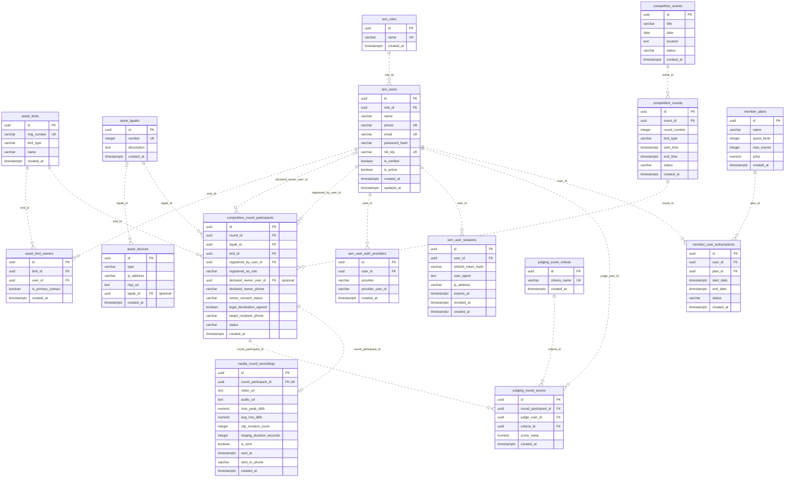
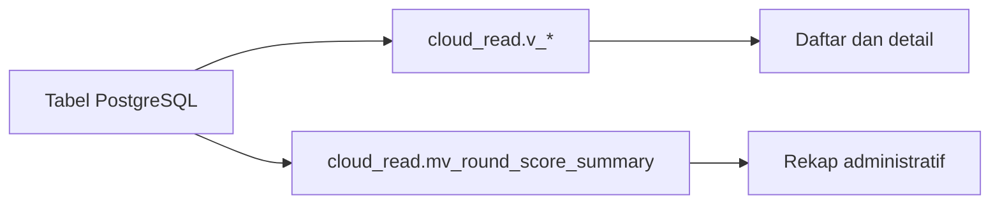

# ERD PostgreSQL Kicau Mania

Diagram ini mengikuti tabel dan foreign key dari dump PostgreSQL untuk `cloud-app`. Nama seperti `competition_rounds` pada diagram mewakili `competition.rounds`. [Dump sumber](../../db-dump/full_db.dump)

## Tabel dan relasi

Mulai dari `competition.events → competition.rounds → competition.round_participants`. Dari peserta ronde, ikuti relasi ke burung, lapak, skor, dan rekaman. Setiap peserta dapat memiliki banyak baris skor dan maksimal satu baris rekaman. Lapak pada perangkat dan pemilik yang dideklarasikan pada pendaftaran bersifat opsional.

## Keunikan gabungan

| Tabel | Kolom yang harus unik sebagai pasangan atau kombinasi |
| --- | --- |
| `asset.bird_owners` | `bird_id`, `user_id` |
| `competition.round_participants` | `round_id`, `lapak_id` |
| `competition.rounds` | `event_id`, `round_number` |
| `iam.user_auth_providers` | `provider`, `provider_user_id` |
| `judging.round_scores` | `round_participant_id`, `judge_user_id`, `criteria_id` |

## Aturan penghapusan

| Tabel anak | Foreign key | Aksi saat induk dihapus |
| --- | --- | --- |
| `asset.bird_owners` | `bird_id` → `asset.birds` | `CASCADE` |
| `asset.bird_owners` | `user_id` → `iam.users` | `CASCADE` |
| `asset.devices` | `lapak_id` → `asset.lapaks` | `SET NULL` |
| `competition.round_participants` | `bird_id` → `asset.birds` | `RESTRICT` |
| `competition.round_participants` | `declared_owner_user_id` → `iam.users` | `SET NULL` |
| `competition.round_participants` | `lapak_id` → `asset.lapaks` | `RESTRICT` |
| `competition.round_participants` | `registered_by_user_id` → `iam.users` | `RESTRICT` |
| `competition.round_participants` | `round_id` → `competition.rounds` | `CASCADE` |
| `competition.rounds` | `event_id` → `competition.events` | `CASCADE` |
| `iam.user_auth_providers` | `user_id` → `iam.users` | `CASCADE` |
| `iam.user_sessions` | `user_id` → `iam.users` | `CASCADE` |
| `iam.users` | `role_id` → `iam.roles` | `RESTRICT` |
| `judging.round_scores` | `criteria_id` → `judging.score_criteria` | `RESTRICT` |
| `judging.round_scores` | `judge_user_id` → `iam.users` | `RESTRICT` |
| `judging.round_scores` | `round_participant_id` → `competition.round_participants` | `CASCADE` |
| `media.round_recordings` | `round_participant_id` → `competition.round_participants` | `CASCADE` |
| `member.user_subscriptions` | `plan_id` → `member.plans` | `RESTRICT` |
| `member.user_subscriptions` | `user_id` → `iam.users` | `CASCADE` |

## Jalur baca aplikasi

`cloud_read` berisi 16 view daftar/detail dan satu materialized view rekap administratif. View membaca tabel pada ERD. Rekap menggabungkan peserta ronde, ronde, dan skor, dengan satu baris per peserta ronde. [Panduan SQL](README.md)

Cakupan diagram adalah PostgreSQL untuk fitur bisnis cloud. SQLite arena dan journal pertukaran cloud dijelaskan di dokumentasi masing-masing. [Offline-first arena](../../local-app/OFFLINE-FIRST.md) · [Cloud exchange](../README.md)
