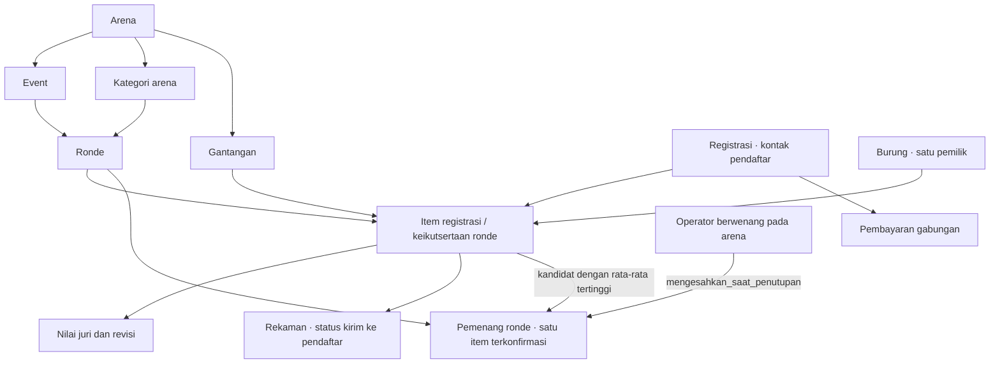
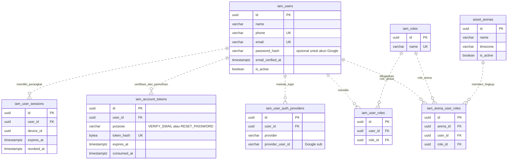
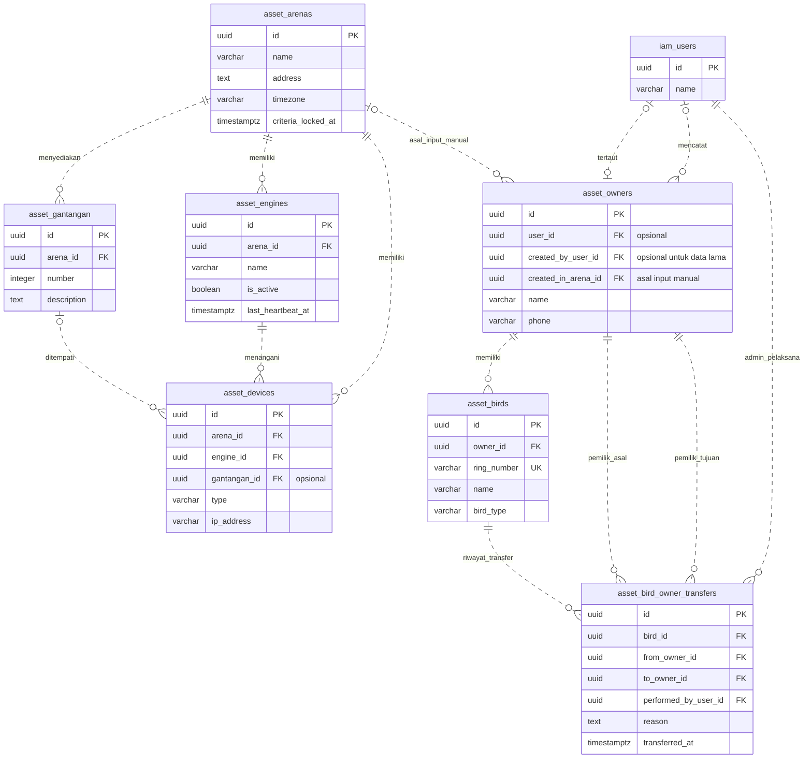
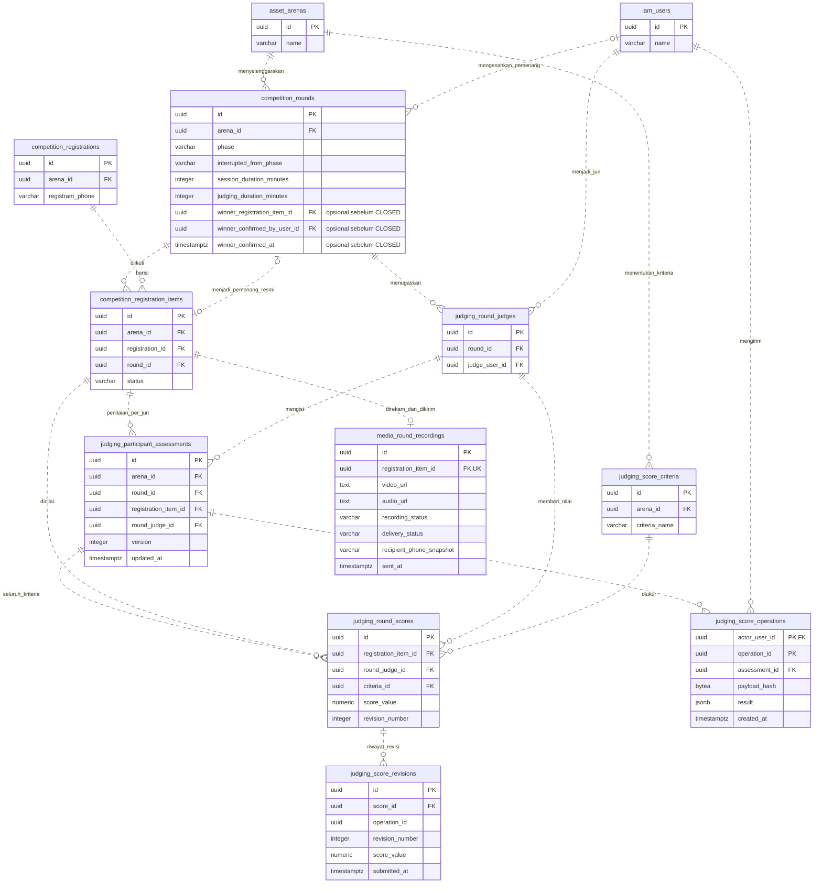

# Rancangan ERD Multi-Arena Kicau Mania

> **Status — REVISI UNTUK PERSETUJUAN ERD**
>
> Tanggal revisi 10 November 2026. Keputusan ronde mandiri dan satu pemenang telah dikunci untuk rancangan ini. Kriteria bersama per arena telah diputuskan untuk tahap ini. File migrasi 004–007 sudah disiapkan berdasarkan rancangan ini; penerapan pada database aplikasi belum dilakukan. Dump sumber tetap dipertahankan. SQL dan backend bisnis kini mengikuti migrasi ini; frontend serta integrasi engine belum termasuk.

Acuan bisnis berasal dari [diskusi awal](../../discussion_11062026_erd.txt), [diskusi 9 November](../../discussion_11092026_target%20beres.txt), dan keputusan lanjutan mengenai bracket serta pengesahan pemenang. Nama entitas seperti `asset_arenas` dalam diagram mewakili tabel `asset.arenas`. Atribut yang ditampilkan dipilih untuk menjelaskan hubungan dan aturan bisnis.

Urutan penerapan dan rollback tersedia di [panduan migrasi](README.md). Migrasi menjaga constraint database; UseCase mengoordinasikan aturan semantik seperti kelengkapan penilaian, otorisasi arena, dan pengesahan pemenang. Integrasi frontend dan engine masih menjadi tahap berikutnya.

## 1. Gambaran utama

Setiap item registrasi menyatakan satu burung mengikuti satu ronde. Status dan gantangan pada item tersebut menunjukkan apakah keikutsertaan sudah dikonfirmasi. Satu header registrasi menampung beberapa item dan pembayaran gabungannya.

Ronde berdiri sendiri. Bracket dikelola manual di luar aplikasi; operator membuat ronde dan menentukan pesertanya secara terpisah. Tidak ada tabel bracket, hubungan ronde berikutnya, atau mekanisme otomatis peserta lolos. Setiap ronde yang ditutup resmi mempunyai tepat satu pemenang, tanpa otomatis mendaftarkan pemenang tersebut ke ronde lain.

Node pemenang merangkum field pada ronde, bukan tabel tambahan. Pemenang belum terisi sebelum penutupan; saat `CLOSED` wajib ada satu pemenang, sedangkan ronde `CANCELLED` tidak mempunyai pemenang.

**Keputusan yang sudah dikunci**

- Bracket manual berada di luar aplikasi; ronde tidak memiliki relasi kemajuan antarronde.
- Burung yang sama boleh mengikuti beberapa ronde melalui item registrasi berbeda. Pada ronde yang sama, satu burung tetap hanya mempunyai satu keikutsertaan aktif.
- Rekap rata-rata menentukan kandidat tertinggi dengan bobot juri dan kriteria yang sama. Operator mengesahkan satu pemenang bersama penutupan resmi; jika seri, operator memilih dari kandidat yang seri.
- Kategori dikelola per arena; multi-role, batas tiga perangkat aktif per akun, pemilik tunggal burung, dan penerima video dari kontak pendaftar tetap dipertahankan.

**Penyederhanaan untuk review**

- Satu item registrasi menyimpan burung, ronde, gantangan, dan status keikutsertaan.
- Penugasan juri ronde langsung menunjuk akun juri.
- Seluruh ronde memakai daftar kriteria bersama per arena. Daftar dan artinya dikunci setelah pertama digunakan, ditandai `arenas.criteria_locked_at`.
- Status serta tujuan pengiriman video berada pada rekaman.
- Ronde menyimpan fase saat ini. History revisi nilai dan transfer pemilik tetap ditampilkan karena keduanya sudah menjadi kebutuhan yang disepakati.

| Aturan lintas arena | Bentuk hubungan yang diusulkan |
| --- | --- |
| Banyak arena berjalan bersamaan | Event, registrasi, gantangan, dan engine memiliki `arena_id`. |
| Nomor gantangan dapat sama di arena berbeda | Unik pada pasangan `(arena_id, number)`. |
| Kategori dikelola per arena | Admin arena membuat kategorinya sendiri. Kode kategori unik pada pasangan `(arena_id, code)`. |
| Satu registrasi untuk satu arena | Item registrasi, ronde, dan gantangan harus berada pada arena header registrasi. |
| Satu ronde aktif per arena | Ronde berjalan atau terinterupsi membatasi arena terkait. Arena lain dapat menjalankan rondenya. |
| Akun dapat bertugas di beberapa arena | Penugasan role menghubungkan akun, role, dan arena. |
| Burung/pemilik dipakai lintas arena | Master burung dan pemilik bersifat global. Riwayat keikutsertaan berada pada item registrasi. |

## 2. Akun, role, dan perangkat

Akun mempunyai role global melalui `iam.user_roles` dan penugasan operasional melalui `iam.arena_user_roles`. Superadmin mengelola lintas arena. Operator, admin arena, dan juri memperoleh akses melalui penugasan arena.

- Pasangan akun–role global dan kombinasi akun–arena–role operasional harus unik.
- Login email/password berjalan tanpa Google; akun password harus memverifikasi email. Google adalah metode tambahan dan pengaitan akun lama dilakukan secara eksplisit. Akun Google-only tidak harus mempunyai password.
- Token verifikasi/reset sekali pakai disimpan sebagai hash. Sesi menyimpan hash access/refresh token, bukan token mentah; detail teknis tersebut tidak ditampilkan seluruhnya pada diagram.
- Maksimal tiga perangkat/browser aktif dihitung per akun secara keseluruhan. Login ulang pada perangkat yang sama memakai slot yang sama. Perangkat keempat ditolak.
- Penugasan sebagai juri arena perlu dilanjutkan dengan penugasan pada ronde, yang terlihat pada diagram penjurian.

## 3. Arena, perangkat, burung, dan pemilik

Setiap arena mengelola gantangan dan engine media. Fase awal menggunakan satu engine media aktif per arena. Setiap burung wajib menunjuk tepat satu pemilik. Seorang pemilik dapat memiliki beberapa burung dan dapat ditautkan ke akun cloud.

- Tautan akun pada master pemilik opsional dan unik jika terisi. Pemilik tanpa akun tetap dapat tercatat.
- Peserta mengelola burungnya sendiri. Petugas mengelola master manual pada arena asal inputnya; provenance ini tidak membatasi burung mengikuti arena lain. Pengaitan owner ke akun hanya oleh superadmin.
- Transfer dilakukan superadmin dengan alasan dan history. Pemilik aktif disimpan pada `asset.birds.owner_id`.
- Burung yang pernah mengikuti lomba tetap mempunyai riwayat peserta meskipun pemiliknya kemudian berubah.
- Perangkat boleh belum ditempatkan pada gantangan. Arena engine, perangkat, dan gantangan yang ditautkan harus sesuai.

## 4. Registrasi, pembayaran, dan keikutsertaan

Pendaftaran manual menyimpan nama dan kontak pendaftar dengan akun opsional. Pendaftaran online memakai akun login. Satu header registrasi membayar beberapa item burung/ronde dalam satu arena. Tarif per item disimpan sebagai snapshot saat pendaftaran.

```mermaid
erDiagram
    asset_arenas {
        uuid id PK
        varchar name
    }
    iam_users {
        uuid id PK
        varchar name
    }
    competition_events {
        uuid id PK
        uuid arena_id FK
        varchar title
        date date
    }
    competition_categories {
        uuid id PK
        uuid arena_id FK
        varchar code
        varchar name
    }
    competition_rounds {
        uuid id PK
        uuid arena_id FK
        uuid event_id FK
        uuid category_id FK
        integer round_number
        varchar bird_type
        numeric entry_fee
        varchar phase
        uuid winner_registration_item_id FK "opsional sebelum CLOSED"
        uuid winner_confirmed_by_user_id FK "opsional sebelum CLOSED"
        timestamptz winner_confirmed_at "opsional sebelum CLOSED"
    }
    asset_birds {
        uuid id PK
        varchar name
    }
    asset_gantangan {
        uuid id PK
        uuid arena_id FK
        integer number
    }
    competition_registrations {
        uuid id PK
        uuid arena_id FK
        uuid registered_by_user_id FK "opsional"
        uuid created_by_user_id FK
        varchar registration_source
        varchar registrant_name
        varchar registrant_phone
        numeric total_amount
        varchar status
    }
    competition_registration_items {
        uuid id PK
        uuid arena_id FK
        uuid registration_id FK
        uuid round_id FK
        uuid bird_id FK
        uuid gantangan_id FK "opsional sebelum konfirmasi"
        numeric entry_fee_snapshot
        varchar status
    }
    competition_registration_payments {
        uuid id PK
        uuid arena_id FK
        uuid registration_id FK
        numeric amount
        varchar method
        text proof_reference
        varchar status
        uuid verified_by_user_id FK "opsional sebelum verifikasi"
        timestamptz verified_at
    }

    asset_arenas ||..o{ competition_events : menyelenggarakan
    competition_events ||..o{ competition_rounds : berisi
    asset_arenas ||..o{ competition_categories : memiliki_kategori
    competition_categories ||..o{ competition_rounds : mengelompokkan
    asset_arenas ||..o{ competition_registrations : menerima
    iam_users |o..o{ competition_registrations : akun_pendaftar
    iam_users ||..o{ competition_registrations : membuat_catatan
    competition_registrations ||..o{ competition_registration_items : berisi
    competition_registrations ||..o{ competition_registration_payments : pembayaran_gabungan
    iam_users |o..o{ competition_registration_payments : memverifikasi
    competition_rounds ||..o{ competition_registration_items : dituju
    competition_registration_items |o..o| competition_rounds : menjadi_pemenang_resmi
    iam_users |o..o{ competition_rounds : mengesahkan_pemenang
    asset_birds ||..o{ competition_registration_items : didaftarkan
    asset_gantangan |o..o{ competition_registration_items : alokasi_tempat
```

- Header dapat berstatus draft ketika belum mempunyai item atau pembayaran. Item berstatus menunggu pembayaran sampai pembayaran gabungan diverifikasi dan seluruh alokasi berhasil. Item terkonfirmasi menyimpan gantangan yang wajib terisi.
- Metode pembayaran awal adalah tunai atau transfer dengan verifikasi operator/admin. Satu pembayaran berlaku untuk header beserta itemnya. Tabel pembayaran dapat menyimpan beberapa percobaan dengan satu pembayaran gabungan yang diverifikasi untuk konfirmasi.
- Pendaftar tanpa akun disimpan pada snapshot nama dan kontak. `created_by_user_id` menunjuk operator untuk input manual atau akun pendaftar untuk input online.
- Kontak pendaftar menjadi penerima video. Transfer pemilik burung tidak mengubah snapshot registrasi.
- Untuk item aktif, satu burung hanya memiliki satu keikutsertaan pada ronde yang sama. Gantangan yang sudah dialokasikan hanya dapat dipakai satu item aktif per ronde. Item yang dibatalkan melepas alokasi. Arena header, item, ronde, serta gantangan harus sama.
- Burung boleh didaftarkan pada ronde berbeda menggunakan item lain. Hubungan ini menyatakan keikutsertaan terpisah, bukan hubungan lolos atau promosi bracket.
- Kategori dimiliki arena melalui `competition.categories.arena_id`. Admin hanya mengelola kategori pada arena tempat ia ditugaskan. Arena berbeda boleh memiliki kode kategori yang sama, misalnya `VIP`, dengan keunikan `(arena_id, code)`.
- Kategori ronde harus berasal dari arena ronde tersebut. Rancangan SQL memakai FK gabungan `competition.rounds(category_id, arena_id)` ke `competition.categories(id, arena_id)`, dengan constraint unik pendukung `(id, arena_id)` pada kategori.

### Contoh satu burung mengikuti dua ronde

| Burung | Item registrasi | Ronde | Makna |
| --- | --- | --- | --- |
| Burung A | Item 001 | Ronde 1 | Keikutsertaan pada Ronde 1. |
| Burung A | Item 002 | Ronde 2 | Keikutsertaan baru pada Ronde 2. |

Kedua item menunjuk `bird_id` yang sama dan `round_id` berbeda, serta dapat berada pada header registrasi yang sama selama arenanya sama. Operator menyiapkan peserta masing-masing ronde secara terpisah. Burung A boleh ikut Ronde 2 terlepas dari hasil Ronde 1; tidak ada hubungan bracket antara kedua item tersebut.

## 5. Penjurian, revisi nilai, dan media

Setiap ronde memiliki daftar juri yang ditugaskan langsung melalui `judge_user_id`. Kriteria berasal dari daftar bersama arena yang dikunci setelah pertama digunakan. Item registrasi berstatus terkonfirmasi menjadi peserta yang dinilai dan direkam. Rekap seluruh nilai wajib menghasilkan kandidat pemenang untuk disahkan operator saat menutup ronde.

| Aturan | Makna pada rancangan |
| --- | --- |
| Juri | Pasangan `(round_id, judge_user_id)` unik. Akun harus memiliki penugasan juri pada arena ronde. Daftar juri dikunci saat ronde dimulai. |
| Kriteria | Daftar bersama per arena, nama unik per arena, dan terkunci setelah ronde pertama dimulai. |
| Fase ronde | `PREPARED → RUNNING → JUDGING → CLOSED`, dengan `INTERRUPTED` dan `CANCELLED`. Operator mengendalikan perpindahan fase. |
| Waktu penilaian | Submit dan revisi diterima pada fase `JUDGING` untuk item terkonfirmasi. |
| Kelengkapan | Seluruh item terkonfirmasi, juri yang ditugaskan, dan kriteria arena harus sudah dinilai sebelum penutupan. |
| Nilai | Satu skor berlaku per kombinasi item–juri ronde–kriteria. Nilai bulat 1–10 dan berbobot sama. Skor terkini dan history revisi diperbarui bersama. |
| Kandidat pemenang | Rata-rata seluruh nilai wajib yang berlaku dihitung untuk setiap peserta terkonfirmasi. Seluruh juri dan kriteria berbobot sama. Kandidat adalah peserta dengan rata-rata tertinggi; gunakan nilai sebelum pembulatan tampilan untuk membandingkan dan menentukan seri. |
| Pengesahan | Setelah semua penilaian wajib lengkap, operator mengonfirmasi kandidat tertinggi. Jika seri, operator memilih tepat satu dari kandidat yang seri; tidak dapat memilih peserta di luar kandidat tertinggi. |
| Penutupan resmi | Pengesahan pemenang dan transisi `JUDGING → CLOSED` merupakan satu tindakan atomik pada implementasi kelak. `CLOSED` wajib memiliki pemenang, akun pengesah, dan waktu pengesahan; ketiga field kosong sebelum penutupan dan pada `CANCELLED`. Ronde tanpa peserta terkonfirmasi tidak dapat ditutup resmi. |
| Lingkup pemenang | `winner_registration_item_id` menunjuk item terkonfirmasi dari ronde dan arena yang sama. `winner_confirmed_by_user_id` menunjuk operator yang berwenang pada arena ronde. |
| Hasil terkunci | Nilai dan pemenang tidak dapat diubah setelah `CLOSED`. Pembukaan ulang ronde serta koreksi hasil resmi belum disediakan pada tahap ini. |
| Konsistensi | Item dan juri pada skor harus berasal dari ronde yang sama. Kriteria harus berasal dari arena ronde tersebut. |
| Submit dan revisi | Satu assessment per peserta–juri menyimpan versi seluruh kriteria. Seluruh nilai dan history direvisi dalam satu transaksi. |
| Pengiriman ulang | Ledger aktor–operation ID menyimpan hash payload dan hasil. Payload sama mengembalikan hasil semula; payload berbeda ditolak. Expected version mencegah revisi saling menimpa. |
| Konektivitas | Cloud menjadi sumber nilai resmi. Gangguan koneksi engine menginterupsi arena terkait dan resume dilakukan operator. |
| Media | Engine/worker sistem menulis metadata rekaman dan status pengiriman. Rekaman terhubung ke item registrasi. |
| Penerima | Worker menyalin kontak pendaftar dari header registrasi ke `recipient_phone_snapshot` pada rekaman saat menyiapkan pengiriman. |
| Jadwal | Durasi 10 menit lomba, 15 menit penjurian, jeda siang, dan batas pukul 17 menjadi panduan operator. |

Contoh satu ronde dengan 24 item terkonfirmasi, 2 juri, dan 3 kriteria membutuhkan **144 nilai kriteria**. Item registrasi sudah menyediakan daftar peserta, sedangkan `round_judges` menyediakan daftar juri yang bertugas.

## Cara membaca relasi

Pada diagram ER, `||` berarti tepat satu, `|o` atau `o|` berarti nol atau satu, dan `o{` berarti nol atau banyak. FK opsional dapat kosong, seperti akun pemilik, akun pendaftar manual, dan gantangan sebelum item dikonfirmasi.

Relasi `menjadi_pemenang_resmi` bersifat nol-atau-satu di kedua sisi: satu ronde menunjuk maksimal satu item pemenang dan satu item hanya dapat menjadi pemenang pada rondenya sendiri. Ini berbeda dari relasi keikutsertaan satu ronde ke banyak item. Satu akun operator dapat mengesahkan banyak ronde; setiap ronde memiliki maksimal satu akun pengesah. FK pemenang dan pengesah opsional secara umum karena ronde belum tentu ditutup, tetapi wajib terisi pada fase `CLOSED`.

Lingkup arena diperoleh melalui event/ronde, registrasi, dan master aset. `arena_id` ditampilkan pada titik lingkup utama. Pada tahap SQL, kombinasi relasi perlu menjamin bahwa kategori, item registrasi, gantangan, juri, kriteria, serta pemenang saling sesuai. Rujukan pemenang perlu menjamin kecocokan item–ronde–arena, bukan hanya keberadaan ID item. Penugasan operator pengesah juga harus diperiksa pada arena ronde. Batas tiga perangkat berlaku global per akun.

## Read layer dan laporan administratif

View `cloud_read.v_*` hanya dipakai untuk baca. Create/update/delete menulis tabel sumber. Pembacaan kredensial, otorisasi internal dan locking transaksi memakai jalur internal terbatas.

`v_round_score_summary` membaca skor berlaku untuk rekap aktif dan penetapan pemenang. `mv_round_score_summary` serta `mv_arena_dashboard` adalah snapshot laporan, dengan waktu snapshot/refresh tersimpan pada metadata pemeliharaan. Kedua materialized view bukan sumber keputusan penutupan resmi. Tabel pemeliharaan snapshot dan kepemilikan seed migrasi adalah metadata teknis, bukan entitas lomba pada diagram utama.

Induk assessment diperlukan karena satu submit/revisi sekarang mencakup seluruh kriteria satu peserta. Ledger operasi diperlukan untuk pengiriman ulang aman; history nilai tetap melekat pada skor tiap kriteria. FK gabungan skor ke assessment memakai pasangan item–juri ronde.

## Ringkasan penyederhanaan

| Bagian | Rancangan untuk review |
| --- | --- |
| Peserta ronde | Item registrasi menyimpan status serta gantangan dan langsung dipakai skor/rekaman. |
| Ronde dan bracket | Ronde mandiri; bracket manual di luar aplikasi, tanpa relasi ronde berikutnya atau peserta otomatis lolos. |
| Burung lintas ronde | Burung yang sama dapat mengikuti beberapa ronde melalui item berbeda, tetap satu keikutsertaan aktif per burung per ronde. |
| Pemenang | Satu kandidat tertinggi disahkan operator saat penutupan; seri dipilih dari kandidat tertinggi. Identitas item, pengesah, dan waktu disimpan pada ronde. |
| Penugasan juri | `round_judges` menunjuk `users` melalui `judge_user_id`. |
| Kriteria | Daftar bersama per arena, dikunci setelah pertama digunakan. |
| Pengiriman video | Status kirim, tujuan, dan waktu kirim disimpan pada rekaman. |
| Fase ronde | Fase sekarang dan fase asal interupsi disimpan pada ronde. |
| Revisi nilai | Assessment berversi per peserta–juri; seluruh kriteria/history atomik, dengan ledger deduplikasi. |
| Transfer pemilik | Pemilik aktif disimpan pada burung dengan history transfer admin. |

Rancangan tetap memuat multi-arena, kategori buatan admin arena, registrasi multi-item, pembayaran gabungan, serta pendaftar manual dengan akun opsional. Auth provider ditampilkan pada diagram akun. Paket/langganan membership tetap ada pada skema sumber dan belum masuk API bisnis tahap ini. [Skema sumber saat ini](../../db-dump/full_db.dump)
