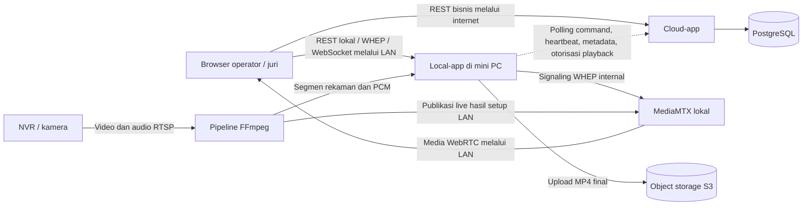

# Integrasi local-app dan cloud-app

Status ditinjau dari source pada **11 November 2026**. Dokumen ini menjelaskan hubungan sistem, bukan bukti bahwa seluruh integrasi sudah aktif di VPS atau siap pada NVR arena. Untuk instalasi, gunakan [README local-app](../local-app/README.md) dan [README cloud-app](../cloud-app/README.md).

## 1. Pembagian tanggung jawab

| Komponen | Tanggung jawab |
| --- | --- |
| Cloud-app dan PostgreSQL | Akun/login, hak akses arena, peserta, event/ronde, registrasi/pembayaran, skor/revisi serta pengesahan hasil. Data bisnis memerlukan koneksi ke cloud. |
| Local-app di mini PC | Setup sumber, lifecycle sesi media, live LAN, audio/metrik, recording, restream, upload dan journal operasional media. Tidak menyimpan penilaian atau akun event offline. |
| NVR/kamera dan MediaMTX | NVR menyediakan sumber RTSP. Pipeline lokal memproses sumber dan MediaMTX melayani media WebRTC; gateway local-app menangani signaling WHEP. |
| Frontend operator/juri | Mengirim operasi bisnis ke cloud dan menghubungkan player/metrik langsung ke engine LAN sesuai mode akses. Backend tidak menyediakan dashboard media. |
| Object storage | Menerima hasil rekaman final dari uploader local-app ketika konfigurasi S3 tersedia. Metadata ditujukan ke cloud melalui kontrak pendamping. |

Garis putus-putus menunjukkan kontrak komunikasi yang client engine-nya tersedia, tetapi endpoint pendamping cloud belum didaftarkan. Diagram pipeline menunjukkan jalur normalisasi hasil setup LAN; konfigurasi sumber lama juga dapat memakai tarikan RTSP on-demand oleh MediaMTX. Browser tidak mengunduh live dari PostgreSQL atau S3, dan byte video LAN tidak perlu melewati cloud.

## 2. Dua mode engine

| Aspek | LAN mandiri (`ENGINE_ACCESS_MODE=lan`) | Cloud (`ENGINE_ACCESS_MODE=cloud`) |
| --- | --- | --- |
| Tujuan | Menjalankan media di arena tanpa login/koneksi cloud. | Menonton dengan otorisasi cloud dan komunikasi mesin yang dikonfigurasi. |
| Setup | API setup tersedia meskipun NVR/binary belum siap; konfigurasi Windows dilindungi DPAPI. | Konfigurasi sumber/env dibaca saat startup; API setup LAN tidak didaftarkan. |
| Viewer | Channel, WHEP dan WebSocket dibatasi subnet pembaca; playback tidak memakai tiket cloud. | WHEP baru memerlukan tiket playback yang diverifikasi ke cloud. Katalog/WebSocket memakai autentikasi operator layanan yang tersedia saat ini; ini bukan pengganti login juri cloud. |
| Kontrol tanpa akun | Hanya koneksi loopback langsung dengan Host localhost/IP loopback, origin yang diizinkan dan nonce kontrol. | Tidak ada kontrol nonce LAN; gunakan kredensial operator layanan atau command cloud setelah integrasi tersedia. |
| Kesiapan | Memerlukan runtime media siap; tidak menunggu heartbeat cloud. | Memerlukan kesiapan media serta syarat koneksi/konfigurasi cloud. |

Dalam mode LAN, operator membuka frontend pada PC engine melalui origin loopback yang diizinkan, mengambil `data.nonce` dari bootstrap, lalu mengirim `X-Local-Control` untuk mutasi. Membuka halaman dari IP LAN atau menambahkan forwarded header tidak menjadikan perangkat lain operator lokal. Bearer layanan tetap merupakan akses tersendiri, bukan token untuk dibagikan ke viewer.

Lihat [setup API](../local-app/docs/setup-api.md) untuk endpoint, payload, CORS dan konfigurasi jaringan. Tidak ada penemuan port aplikasi secara acak atau perubahan otomatis pada router/NVR.

## 3. Alur frontend ke bisnis dan live

Frontend yang sama dapat memakai dua alamat layanan: API cloud untuk data bisnis dan alamat engine arena untuk media. Pemisahan backend tidak mewajibkan dua frontend. Identitas arena/channel harus konsisten saat integrasi diaktifkan; pemetaan tersebut belum otomatis tersedia hanya karena kedua backend berjalan.

1. Login, registrasi dan penilaian dikirim ke API cloud. Local-app tidak menjadi jalur REST untuk menyimpan skor.
2. Engine dikonfigurasi dan sesi media dimulai secara eksplisit. Setup/restart tidak otomatis merekam. Start sesi mengaktifkan live, recording, analisis audio bila tersedia, dan restream pilihan.
3. Mode LAN: browser yang berada dalam subnet pembaca mengambil katalog dan membuka WHEP ke local-app tanpa tiket cloud.
4. Mode cloud, setelah endpoint pendamping tersedia: frontend meminta tiket dari cloud, mengirim SDP offer beserta tiket ke gateway WHEP lokal, dan gateway meminta grant ke cloud. Media kemudian mengalir langsung antara MediaMTX dan browser melalui LAN.
5. Audio PCM dan metrik diterima melalui WebSocket sesuai aturan akses mode engine. Mode cloud belum menyediakan mekanisme tiket pengguna untuk WebSocket pada pekerjaan ini; jangan menaruh API_TOKEN pada frontend juri untuk mengakalinya.
6. Stop menghentikan seluruh media sesi dan memasuki finalisasi. Upload/pelaporan berjalan terpisah setelahnya. HTTP 202 hanya berarti pekerjaan diterima; baca status sesi untuk memastikan proses/finalisasi selesai.

Browser harus dapat menjangkau IP mini PC dan port media yang dibutuhkan. Untuk frontend cloud HTTPS, engine juga perlu HTTPS dengan sertifikat dipercaya, origin CORS yang sesuai, DNS LAN yang benar, serta penanganan izin jaringan lokal browser. Tidak ada proxy media cloud atau akses live jarak jauh otomatis. Restream adalah jalur publikasi tersendiri ke target yang dikonfigurasi.

## 4. Komunikasi keluar engine dan kredensial

Local-app menginisiasi request HTTPS ke cloud sehingga model polling command tidak memerlukan cloud membuka koneksi masuk langsung ke mini PC. Ini berbeda dengan browser arena yang tetap perlu menjangkau engine untuk playback.

| Alur | Perilaku engine | Status cloud |
| --- | --- | --- |
| Command | Poll, periksa identitas/expiry/payload, simpan journal sebelum eksekusi, jalankan `media.session.start` atau `media.session.stop`, laporkan hasil sampai diakui. | Endpoint polling dan hasil belum aktif. |
| Heartbeat | Kirim identitas/status media sesuai interval konfigurasi. | Penerimaan heartbeat dan koordinasi bisnis terkait belum aktif. |
| Metadata | Simpan update rekaman/upload dan kirim ulang sampai acknowledgment cocok. | Endpoint penerimaan metadata belum aktif. |
| Playback cloud | Verifikasi tiket dan scope sebelum membuka sesi WHEP. | Penerbitan tiket dan endpoint otorisasi belum aktif. |
| Upload S3 | Upload hasil final READY dengan retry melalui manifest persisten, jika S3 dikonfigurasi. | Upload byte tidak melewati cloud-app; penerimaan metadata tetap menunggu endpoint cloud. |

Hasil command Start/Stop tidak membuktikan media sudah RUNNING/STOPPED. Journal command, journal sesi dan manifest upload adalah penyimpanan operasional engine, bukan database bisnis/antrean skor offline.

| Kredensial | Pemakai dan batasnya |
| --- | --- |
| Login/access token cloud | Pengguna frontend untuk operasi bisnis cloud; tidak otomatis diterima sebagai token engine. |
| Tiket playback | Grant singkat untuk WHEP mode cloud; berbeda dari API_TOKEN dan token mesin. |
| `API_TOKEN` | Kontrol layanan engine; tidak dibagikan kepada operator/juri melalui frontend pengguna. |
| `X-Local-Control` | Nonce proses untuk kontrol lokal loopback mode LAN; diambil lewat bootstrap, disimpan di memori dan berubah setelah restart. |
| `CLOUD_ENGINE_TOKEN` | Request mesin keluar ke cloud; terpisah dari akun pengguna dan grant playback. |
| Akun NVR serta kunci S3/restream | Kredensial adapter; tidak dikembalikan melalui katalog channel kepada viewer. |

Kontrak payload, envelope dan acknowledgment tetap dirujuk pada [kontrak engine lokal](../local-app/docs/cloud-contract.md) dan [kontrak pendamping cloud](../cloud-app/docs/ENGINE-CONTRACT.md). Kedua kontrak harus diselaraskan ketika endpoint cloud diimplementasikan; panduan ini tidak menambah endpoint atau mengaktifkannya.

## 5. Perilaku saat gagal

| Gangguan | Perilaku yang tersedia / batasnya |
| --- | --- |
| Internet/cloud putus | Recording sesi yang sudah berjalan tetap dilanjutkan. Operasi bisnis cloud tidak dijamin tersedia offline. Mode LAN dapat membuka playback tanpa cloud; mode cloud menolak playback baru jika grant tidak dapat diperiksa. |
| Cloud putus saat media tersambung | Playback yang sudah terhubung mengikuti lifecycle WebRTC/sesi. Jangan menganggapnya pasti bertahan: jalur jaringan, ICE dan proses media tetap memengaruhinya. |
| Satu sumber media putus | Channel dicoba pulihkan tanpa sengaja menghentikan seluruh channel. Gangguan/segmen tercatat; penilaian cloud merupakan alur terpisah. |
| Media gagal tetapi cloud sehat | Kegagalan media tidak otomatis menutup atau membatalkan ronde. Operator tetap menentukan tindakan bisnis. |
| Engine restart | Sesi nonterminal ditandai INTERRUPTED dan segmen diperiksa untuk finalisasi; tidak otomatis melanjutkan media. |
| Upload/pelaporan gagal | Retry/journal operasional mempertahankan pekerjaan sesuai kontrak masing-masing. Jangan menyatakan file sudah ada di S3 atau metadata sudah diakui hanya karena recording selesai. |
| LAN perangkat terputus | Browser kehilangan akses engine; data bisnis masih dapat dijangkau bila perangkat mempunyai jalur internet yang berfungsi. Tidak ada jaminan draft browser atau skor offline dari backend ini. |

## 6. Status implementasi dan langkah membaca berikutnya

**Tersedia pada source:** backend bisnis PostgreSQL, backend media, setup LAN, lifecycle media, client/journal engine–cloud, gateway WHEP, WebSocket, recording dan uploader. Ketersediaan pada source tidak sama dengan semua layanan eksternal telah dikonfigurasi atau lulus penerimaan operasional.

**Belum terhubung penuh:** endpoint command/hasil, heartbeat, metadata dan playback cloud; pemetaan/grant frontend sesuai arena/penugasan; serta aksi ronde cloud yang otomatis mengendalikan sesi engine. Saat ini perubahan fase bisnis tidak otomatis memulai atau menghentikan local-app. Frontend end-to-end tidak disediakan oleh penataan dokumen ini.

Rujukan implementasi: [router cloud](../cloud-app/internal/delivery/router.go), [wiring engine](../local-app/internal/app/container.go), [router lokal](../local-app/internal/delivery/router.go), dan [batas integrasi cloud](../cloud-app/README.md#batas-integrasi-dan-verifikasi). Perubahan implementasi berikutnya harus memperbarui status di panduan ini tanpa mengubah catatan meeting atau laporan historis.

Untuk penggunaan nyata, lanjutkan ke [penerimaan media](../local-app/docs/acceptance.md), [verifikasi backend bisnis](../cloud-app/docs/VERIFIKASI-BACKEND.md), dan [runbook deployment](../cloud-app/deployment/devops_runbook.md). Kamera/NVR asli, playback browser, kapasitas mini PC dan layanan cloud eksternal tetap memerlukan verifikasi lingkungan.
