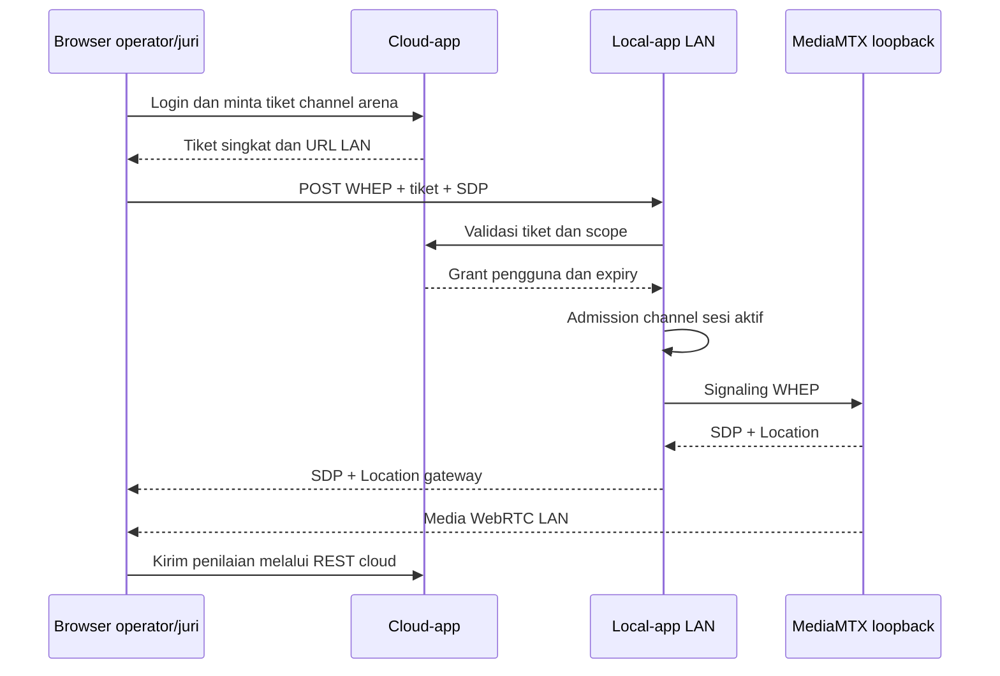

# Alur end-to-end engine media

Panduan rinci: [Memahami mediaengine](media-engine.md). Local-app hanya mengelola media. Login, registrasi, nilai dan status perlombaan tetap menjadi tanggung jawab cloud.

## Startup

`cmd/api/main.go` → konfigurasi env → server mengunci DATA_DIR/RUNTIME_DIR → app merakit dependency → supervisor MediaMTX dan worker audio/upload/restream disiapkan → recovery sesi → worker komunikasi cloud → HTTP server.

Tidak ada capture audio atau recording otomatis. MediaMTX menggunakan sumber on-demand. Journal nonterminal dari boot sebelumnya ditandai INTERRUPTED, segmen diperiksa/finalisasi, dan media tidak dilanjutkan otomatis. `/healthz` menyatakan proses HTTP hidup; `/readyz` memeriksa MediaMTX dan komunikasi cloud, bukan keberhasilan semua kamera.

## Mulai media

Operator memanggil POST `/api/v1/media/sessions` dengan id, channels, dan restreams opsional. Jalur baca: [model](../internal/mediaengine/session/model/session.go) → [handler](../internal/delivery/rest/session/handler.go) → [UseCase](../internal/mediaengine/session/usecase/session.go) → [journal](../internal/mediaengine/session/repository/journal.go).

UseCase memvalidasi pilihan dan disk, menolak sesi aktif lain, menyimpan journal, lalu mereservasi manifest per channel. Setelah diterima dengan 202, worker sesi menjalankan pipeline per channel dan guard. Satu FFmpeg menghasilkan segmen fMP4 A/V dan PCM; analyzer/broadcaster menerima PCM. Restream yang dipilih memakai adapter tersendiri.

Channel gagal dicoba lagi setiap 5 detik dengan segmen baru. Channel lain tetap berjalan. Status GET `/api/v1/media/sessions/:id` memperlihatkan RUNNING/DEGRADED, status channel dan hasil finalisasi.

## Live dari frontend cloud

Frontend tidak perlu dipisah. Request nilai menuju cloud, sedangkan playback menuju engine sesuai arena. Cloud tidak membawa byte video. Channel di luar sesi aktif menolak playback/subscription baru. Cloud mati menolak playback baru tetapi tidak menghentikan recording aktif. Endpoint pendamping cloud masih belum aktif. HTTPS, CORS, ICE, izin LAN browser dan firewall harus diverifikasi pada arena.

## Stop dan hasil

POST `/api/v1/media/sessions/:id/stop` → 202 STOPPING → tutup admission/retry/audio → drain POST WHEP yang telah diterima → tutup WHEP/WebSocket → hentikan restream dan pipeline → FINALIZING → validasi/concat segmen → READY atau FAILED per recording → STOPPED.

Kegagalan menutup playback upstream memicu restart MediaMTX; Stop tidak selesai selama teardown belum dipastikan. FFmpeg dihentikan graceful dengan `q` sebelum batas kill. Finalisasi menggunakan stream-copy dan commit sementara/flush/rename. Gangguan disimpan, celah dilewati. Codec antarsegmen tidak cocok membuat finalisasi gagal dan sumber dipertahankan.

Uploader tetap hidup setelah Stop. Manifest READY → upload S3 → UPLOADED atau retry persisten. Metadata hasil dikirim worker cloud sampai acknowledged. ID/object key lama tidak berubah; field segments/gaps/error bersifat opsional.

## Command cloud

Scheduler polling → UseCase memeriksa scope/expiry/deduplikasi → journal command → CommandExecutor memanggil UseCase sesi → hasil diterima disimpan → report cloud → acknowledgment journal.

Jenis command: `media.session.start` dengan payload Mulai; `media.session.stop` dengan `{ "id": "session-001" }`. Command lama ditolak. Setelah restart, start tidak dieksekusi ulang secara buta; sesi INTERRUPTED memerlukan keputusan operator dan ID sesi baru. Endpoint cloud, ERD dan SQL bisnis tidak diimplementasikan di sini.

## Penerimaan

[Skenario penerimaan media](acceptance.md) mencakup start/stop, channel gagal, PCM lambat, restream, race playback, restart, finalisasi, disk dan upload. Suite tes tidak dijalankan otomatis.

## Ketahanan, response HTTP dan logging

Header umum dipasang sekali melalui middleware bersama: `X-Content-Type-Options: nosniff`, `Cache-Control: no-store`, serta request ID. Middleware CORS global memeriksa origin dan menangani preflight sebelum autentikasi, termasuk pada error/route yang tidak ditemukan. Header `Vary: Origin` dipasang tanpa menimpa nilai Vary lain. Auth hanya memeriksa kredensial; handler tidak memasang ulang header umum. WHEP tetap memiliki Location/ETag dan WebSocket tetap memiliki header upgrade. Gateway membuang header umum duplikat dari upstream MediaMTX.

Response REST mengikuti format park-server-v3: `{"success":true,"message":"...","data":{...}}` atau `{"success":false,"message":"...","errors":...}`. Field data/errors dihilangkan jika nil. Error internal memakai pesan aman dan dapat menyertakan `errors.request_id`; request ID selalu tersedia di header jika berhasil dibuat. Pagination rekaman sekarang berada di `data.items`, `data.next_cursor` (jika ada), dan `data.has_more`; frontend perlu menyesuaikan pembacaan daftar. ID cursor tetap string opaque.

Health dan status engine juga memakai envelope ini. Response 204 tetap tanpa body. SDP/header WHEP dan frame WebSocket mengikuti protokol masing-masing. Payload request mesin ke cloud tetap langsung, tetapi response cloud kini wajib memakai envelope success/message/data/errors; client cloud membuka data sebelum menyerahkannya ke UseCase. Format response mesin lama tanpa envelope tidak didukung. Lihat [kontrak cloud](cloud-contract.md) untuk contoh dan batas penerimaan client.

Rekaman aktif tidak dihentikan hanya karena cloud terputus. Playback baru memerlukan cloud. Engine tidak memutuskan penghentian atau kelanjutan lomba. Journal menyimpan command sebelum eksekusi dan hasil sebelum acknowledgment. Restart merekonsiliasi pekerjaan melalui manifest; start dengan hasil tidak pasti tidak dijalankan ulang secara buta.

Metadata dikirim ulang sampai cloud mengakui ID update. Cloud wajib deduplikasi dan menerapkan versi terbaru. SQLite lama tidak dibaca atau dihapus otomatis; pengarsipannya tindakan operasional terpisah.

Logging mengikuti park-server-v3: Zap, request ID, console development, JSON production dan `${LOG_DIR}/app.log`. Kelola retensi log pada deployment.

Pemeriksaan dasar: `go build ./...`. Suite tes tidak dijalankan otomatis sesuai permintaan. Browser LAN/HTTPS, kamera, rekaman, dan S3 perlu diverifikasi pada lingkungan sebenarnya.
