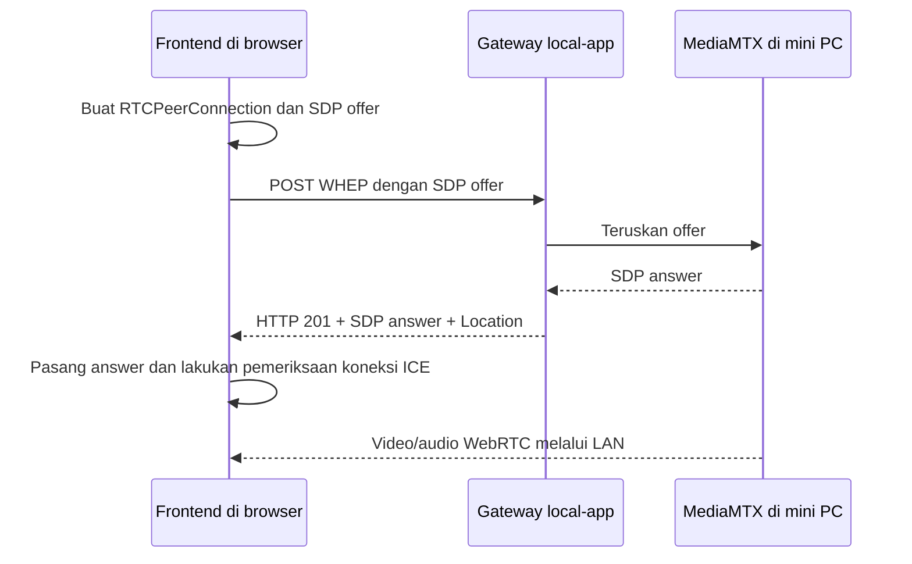

**Iya, ada SDP.** Alurnya lebih mudah dipahami kalau dibagi menjadi **perintah kontrol, pengambilan sumber NVR, dan pengiriman video ke browser**.

Kabel RJ45/WiFi menyediakan jaringan LAN. Di atas jaringan itu, aplikasi menggunakan beberapa protokol berbeda.

| Komunikasi | Protokol | Fungsinya |
|---|---|---|
| Frontend ↔ local-app | **HTTP REST + JSON** | Konfigurasi, Mulai/Stop, daftar channel, dan status. |
| Local-app ↔ NVR | **ONVIF**, bila didukung | Menemukan perangkat dan membaca profil/alamat stream. |
| FFmpeg ↔ NVR | **RTSP melalui TCP** | Membuka dan menerima sumber video/audio. |
| Frontend ↔ gateway local-app | **WHEP melalui HTTP**, membawa **SDP** | Menyiapkan koneksi playback WebRTC. |
| MediaMTX → browser | **WebRTC** | Mengirim video/audio secara langsung melalui LAN. |
| Local-app → frontend | **WebSocket** | Mengirim metrik untuk grafik dan PCM audio bila diperlukan. |

**1. Frontend meminta local-app menghubungkan NVR**

Misalnya:

```text
IP NVR     : 192.168.1.100
IP mini PC : 192.168.1.10
```

Frontend mengirim konfigurasi melalui API local-app. Local-app dapat memakai ONVIF untuk menemukan perangkat dan membaca profil stream. Discovery memakai UDP port 3702; pembacaan profil memakai request SOAP/XML melalui HTTP/HTTPS.

Hasilnya berupa alamat sumber, misalnya:

```text
rtsp://192.168.1.100:554/alamat-channel
```

Alamat sebenarnya mengikuti NVR. Jika ONVIF tidak tersedia, alamat RTSP dapat dimasukkan manual.

**2. Operator menekan Mulai**

Frontend mengirim JSON ke:

```http
POST /api/v1/media/sessions
```

Local-app menjalankan FFmpeg. Pada pipeline hasil setup LAN sekarang, FFmpeg menarik sumber NVR menggunakan RTSP melalui TCP, lalu menghasilkan:

```text
Sumber NVR
   ↓
FFmpeg
   ├── Segmen rekaman di disk
   ├── PCM untuk analisis audio, jika tersedia
   └── Live yang dipublikasikan ke MediaMTX
```

FFmpeg → MediaMTX juga memakai RTSP, tetapi koneksinya internal pada mini PC. Video H.265 dapat dikonversi menjadi H.264 untuk jalur live sesuai konfigurasi.

**3. Frontend meminta menonton: di sinilah SDP digunakan**

**SDP = Session Description Protocol.** Isinya teks yang menjelaskan kemampuan dan parameter sesi, seperti jenis media, codec, serta informasi koneksi. SDP sendiri tidak berisi frame video. [Definisi SDP dari IETF](https://www.rfc-editor.org/rfc/rfc8866.html).

Urutannya:



Request WHEP-nya berupa:

```http
POST /api/v1/playback/gantangan01/whep
Content-Type: application/sdp

[teks SDP offer dari browser]
```

Browser membuat offer melalui `RTCPeerConnection`. MediaMTX membuat answer; gateway local-app meneruskannya. **WHEP mengatur pertukaran signaling melalui HTTP**, sedangkan WebRTC menangani koneksi medianya. MediaMTX mendukung playback melalui WHEP. [Dokumentasi MediaMTX](https://mediamtx.org/docs/read/webrtc).

**4. Setelah tersambung, video mengalir melalui WebRTC**

Pada konfigurasi kita, jalur media menggunakan UDP ke MediaMTX, default port 8189. ICE memeriksa jalur koneksi yang bisa digunakan, lalu media dikirim terenkripsi menggunakan mekanisme WebRTC. [Arsitektur protokol WebRTC](https://www.rfc-editor.org/rfc/rfc8825.html).

Karena itu, **API bisa berhasil diakses tetapi video tetap gagal** apabila alamat kandidat ICE salah atau UDP media terhalang firewall.

Video dan suara live dapat berjalan bersama melalui WebRTC. WebSocket `/api/v1/metrics` adalah jalur tambahan untuk grafik audio; frontend tidak perlu mengambil suara PCM lewat WebSocket hanya untuk mendengar suara pada player video.

Untuk testing Sabtu, gunakan mode LAN: **REST untuk mengontrol → RTSP untuk mengambil NVR → WHEP/SDP untuk menyiapkan playback → WebRTC untuk menampilkan live**. Cloud tidak terlibat dalam jalur tersebut.